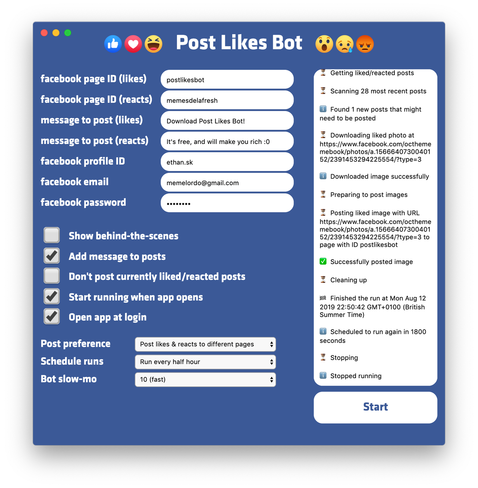

# Post Likes Bot

# WARNING: This project only works with the old facebook. Contributions to get it working with the new facebook will be greatly appreciated.

## A scraper built in Typescript and Node.JS, using Puppeteer to automatically posts things you like from your facebook feed to your facebook page

### https://www.etggames.com/post-likes-bot (the downloads on this page are outdated, please build from source for the latest version)

I use it to auto post memes I like to my meme page, but you can like any type of post for any type of page

## How to use it

First do `npm i && npm run build` (you need TypeScript installed)

Run it with `npm run start`

Or to develop, use `npm run dev`

## License

Source-available under [Ethan Source-Available No-Sale Terms 1.0](LICENSE). You can use and modify the covered code, including internally at work, and share it without charge. Selling the software, modified versions, paid access, or bundles requires a separate commercial license. Earlier licenses and third-party rights remain in force. See [scope and release policy](LICENSING.md).
